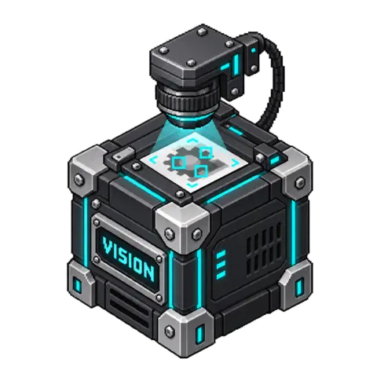

# Vision

[](media/cover.png)

<!-- block-metadata:start -->
[](model.json)
[](compatibility.json)
[](LICENSE)

Verified BloxSmith versions: **1.0.9** (bundled-block tests; see [test evidence](compatibility.json)).
<!-- block-metadata:end -->

Analyze one local image for a clearly defined task through the **OpenAI Responses API**. Return structured data, model-proposed visual evidence and uncertainties separately. Remote analysis is **disabled by default**. This block does not generate images or identify people.

## Connect and configure

1. Set the permitted image directory. Relative paths resolve beneath that directory; an empty setting uses the application root.
2. Enter a full wallet reference, such as `secret://workspace/openai_vision_api`. Unlock the wallet in Studio. Never paste the API key into a block parameter.
3. Write the inspection task and choose the result schema in Advanced settings.
4. Explicitly enable remote analysis, Apply, and reload an already prepared Run.
5. Send a completed local image path to `image`, for example from Camera Photo. Both One Shot and Active Runtime perform a real API request when explicitly enabled and supplied a fresh image.

| Port | Direction | Behavior |
| --- | --- | --- |
| `image` | Input | One local path, or an atomic JSON request with `path`, optional `task` and optional `request_id`. Each delivered image event requests an analysis. |
| `task` | Input | Text, or `{"instruction":"..."}`. Updates the task used by subsequent image requests; **does not analyze a cached image**. |
| `result` | Output | `{request_id, response_id, model, source, data}`. `data` conforms to the configured result schema. Emitted only for a complete, validated response. |
| `evidence` | Output | Correlated `items` labeled `observation` or `inference`, with optional normalized image regions. `verified:false`: these are model proposals, not independently verified measurements. |
| `issues` | Output | `analyzed`, `error` or `cancelled`, uncertainty descriptions and `human_review_required:true`. Normal provider/input failures do not intentionally fail the entire Run. |

For reliable image/task pairing, send a single JSON message to `image`:

```json
{
  "path": "inspection.jpg",
  "request_id": "inspection-001",
  "task": "Describe the panel and determine whether a blue area is visible."
}
```

An embedded task wins over the current `task` input, which wins over the default instruction. Unconnected or empty task inputs fall back to the default. Independent wires are not a transactional pair: deliver the task before the image, or use the atomic request. Repeated image events, including repeated request IDs, are explicit new requests and can incur another charge. The block does not promise a durable queue or exactly-once billing.

## Structured results

The default schema provides a `summary` and nullable `criteria_met`. Define your own strict **object** schema, for example:

```json
{
  "type": "object",
  "properties": {
    "description": {"type": "string"},
    "blue_area_visible": {"type": ["boolean", "null"]}
  },
  "required": ["description", "blue_area_visible"],
  "additionalProperties": false
}
```

Supported schema keywords: `type`, `description`, `enum`, `properties`, `required`, `additionalProperties` and `items`. Every object must require all its properties and refuse additional properties. One base type, optionally nullable, is supported. Use `null` for unknown values. Schemas are limited to 16 KiB, six nested levels and 128 nodes; references, regex patterns and schema composition are deliberately unsupported. All outputs are checked locally with JSON Schema validation before emission.

Evidence regions use `{x,y,width,height}` fractions of the **submitted, EXIF-oriented image**, not raw file coordinates. Missing regions are `null`. Source metadata records original and submitted SHA-256 values, submitted dimensions and oriented source dimensions so a downstream viewer can correlate them. Coordinates are bounded but their perceptual accuracy is not certified. Model-produced content is untrusted data, never an instruction or approval for another block.

## Privacy, limits and lifecycle

- Engine: pinned `gpt-4.1-mini-2025-04-14`; account access and billing remain the user's responsibility. This is remote inference, **not a local model**.
- A request sends the prepared image, task and schema to `https://api.openai.com/v1/responses`. No arbitrary provider URL, external image URL, tool call, conversation history or automatic retry is used. Environment proxies and HTTP redirects are disabled; normal TLS verification remains enabled.
- `store:false` disables storing the Response for later retrieval. It does **not** promise zero provider retention or override OpenAI's applicable data policies.
- Supported single-frame input formats: JPEG, PNG, WebP, BMP and TIFF. Animated/multi-frame files, symbolic links, hard-linked files, directory traversal and nonregular files are refused.
- Source bytes and decoded pixels are bounded. Large images are proportionally reduced; EXIF orientation is applied, alpha is flattened against white, and a new JPEG is encoded without metadata. The source file is never modified. Lossy conversion/resizing may obscure small text; adjust the side limit and inspect uncertainties.
- Image decoding uses a supervised, memory-limited process. Stop terminates local decoding or closes an in-flight HTTP request. An already submitted provider request may still complete and be billed. The block sends no automatic retry after timeout or uncertain network failure.
- Nothing is analyzed on preparation alone. No camera access, video loop, person identification, biometric decision or critical automated decision is implemented. These restrictions are part of the intended use and model instruction, not a certified safety classifier.
- Normal errors emit only `issues`; no fabricated or partial `result` is emitted. A downstream display may retain an older result: correlate request IDs and process the error event rather than treating a retained result as new success.

## Installation and interface

Linux, Python 3.10+, Pillow 10.2+, httpx 0.28.x and jsonschema 4.x. The framework's prerequisite check only diagnoses these requirements; the package does not install dependencies. UI assets and English/French catalogs belong to this release, with no global legacy registry. Modal and inspector share draft settings: Apply saves, closing/Cancel discards. The advanced section keeps schema and resource limits out of the main form.

## Verification

Package-owned suites exercise real image conversion and loopback HTTP, metadata removal, strict response validation, opt-in, wallet errors, interruption, task-only no-replay, and both framework runtimes across bundled/managed/linked origins. A disposable provider and temporary wallet are used; tests do not read user images or use a real API key. Browser tests cover English/French, Apply/Cancel and four viewports. This is integration qualification, not a live-model accuracy assessment or validation of arbitrary inspection tasks.

## License and references

Block code: Apache-2.0. OpenAI service access is separate and subject to its own terms.

- [OpenAI image inputs](https://developers.openai.com/api/docs/guides/images-vision)
- [Structured Outputs](https://developers.openai.com/api/docs/guides/structured-outputs)
- [GPT-4.1 mini capabilities](https://developers.openai.com/api/docs/models/gpt-4.1-mini)
